# CinderMed – Functional specification

## Context and goals

CinderMed (FHIR Mapping Workbench) is a multi-user web application for mapping a tabular dataset to FHIR by working in an Excel-like grid. Under the grid sits a structured model, which is compiled into FHIR Mapping Language (FML). A separate conversion module (V2) runs the FML on the data, for example with Matchbox.

**Scope: any tabular dataset that can be mapped to FHIR.** CinderMed is not built around one dataset. It must work for registries, REDCap exports, EHR and ICU extracts, research databases and trial data, whatever their shape:

| Shape | What it looks like | Example |
| --- | --- | --- |
| Wide table | One row per record (patient, visit), one column per variable | Metastra and MOTU, REDCap-style exports |
| Long table | One row per measurement: a code column says what was measured, value columns hold it (value, unit, time) | MIMIC-IV `labevents` (`itemid`, `valuenum`, `valueuom`), with `d_labitems` as its dictionary |
| Several related tables | Tables linked by keys, each mapped to its own resources, with references across them | MOTU (patients, stays, falls); MIMIC-IV (patients, admissions and dozens of event tables) |
| Large volumes | Files too large to hold in memory, up to hundreds of millions of rows | MIMIC-IV `labevents` |
| Any locale | Dates, decimals and encodings declared per column or per file, at the border | Italian dates and decimals (`17/09/2023`, `11,20`), windows-1252 files |

Metastra, MOTU and MIMIC-IV appear in this document only as examples of these shapes. Every feature is checked against a wide table, a long table and several related tables.

**Out of scope for now:** non-tabular sources, such as JSON or XML documents, HL7 v2 messages, free text and images. A database is in scope through its tables exported as CSV.

**The name.** CinderMed joins *cinder*, an ember from the fire, and *Med*. FHIR is pronounced "fire": CinderMed takes medical datasets and carries them into FHIR.

The spreadsheets used for MOTU ([Arcobelli et al., 2024](https://www.nature.com/articles/s41597-024-03593-6)) and for Metastra show that the spreadsheet works as a collaborative tool. They also show precise limits:

| Observed limit | Example in the sheets |
| --- | --- |
| Instance, path and reference end up in the same cell | `Observation[1].component`, `Condition[0].evidence.detail -> Condition[1]` |
| Concept code and answer code get mixed up | columns "SNOMED single value code" and "entity code"; on row 127 the codes ended up in the Notes column |
| Conditional rules are written in words | "no → I don't create the Condition", "unknown → verificationStatus = unconfirmed" |
| Variables that must be combined | `obs_bloodt_hb` + `obs_bloodt_hb_spec` → a single `valueQuantity` |
| The same mapping repeats at different timepoints | in LastOverview `obs_pain_intervals_2`, `quest_frankel_2` |
| Codes have no display or version, and nobody checks them | "still to finish mapping??" on the Frankel codes |
| References cannot be expressed | MOTU used notes and an ER diagram drawn separately |

**Goals**

1. Keep the naturalness of the table: one row per source variable, cells that someone who knows FHIR can fill in without writing FML or FHIRPath.
2. Make roles, paths, codes, value maps and references explicit and checkable.
3. Export the mapping project as FML (StructureMap, logical model of the source, ConceptMap), CSV or a JSON project file. Data conversion will be a separate module (V2).
4. Track who decided what: statuses, comments, reviews, history.

## Users, roles and principles

The main users know FHIR but do not program: they know what Observation.code or a Reference is, but they should not have to write FML.

| Role | What they do | Permissions |
| --- | --- | --- |
| Project owner | Creates the project, chooses the FHIR version and profiles, invites members | Everything, including member management |
| Mapper | Fills in rows, roles, value maps and references | Edit; submits rows for review |
| Reviewer (clinician or terminologist) | Checks codes and choices, comments, approves | Comment, change status, approve |
| Integration engineer | Generates and exports FML, manages the connection to the conversion module (V2), reads the generated code | Edits technical settings, sees the FML |
| Viewer | Consults the mapping | Read only |

**Design principles**

- **The table first, the structure underneath.** Each cell corresponds to a typed field of the model and never holds free text to be interpreted.
- **Choose instead of type.** FHIR paths, roles, References and codes are picked from lists that filter as you type.
- **The result matters more than the language.** Stakeholders work on tables and guided choices; FML is a product of the export. With the conversion module (V2) they will also be able to judge the generated Bundle.
- **One model, several outputs.** The intermediate model (JSON) is the source of truth; FML is the first generator, Liquid could be the second.
- **The FHIR version is a parameter.** The first release supports R4 and R5: element trees and validation depend on the version chosen in the project (R4, R4B, R5).
- **Excel stays a way in.** Import and export are supported, so people who prefer the spreadsheet can keep using it.

## Conceptual model

A mapping is made of seven objects. The grid shows them as rows and cells, but each has its own fields and validation rules.

| Object | What it represents | Main fields | What it replaces in the spreadsheets |
| --- | --- | --- | --- |
| Project | A dataset to map | name, FHIR version, profiles/IGs, terminology server, members | the Excel file |
| Source | One or more input tables (CSV/Excel) and their columns | per table: name, row key, description; per column: name, type, label, **semantic description**, allowed values (each with its own description) | the Label, Description, Variable, Data Type, Default values, REDCap code columns |
| Role | A **role** of a FHIR resource in the mapping template, not a real resource | generated id `Type[n]` (e.g. `Condition[0]`), role label (e.g. "metastasis"), description, profile, multiplicity, context, creation condition | `Observation[1]`, `Encounter[0]` |
| Mapping row | Links a column (or a constant) to an element of a role | column, role, element path, transform, auxiliary column, status, notes | the Resource, Field, Note columns |
| Value map | Translation of the values of a categorical column into codes | source value → Coding (system, code, display, version) + action | the SNOMED and LOINC columns and the continuation rows |
| Reference | A typed link between two roles | source role, Reference element, target role | the Reference column, the notes, the ER diagram |
| Template | A reusable group of roles and rows | parameters: column suffix or prefix, context Encounter | remapping FirstOverview and LastOverview by hand |

**A role, not a resource.** A role separates, within the same resource type, different groups of source fields. In Metastra `Patient[0]` is the only Patient role, while `Condition[0]` (metastasis) and `Condition[1]` (osteoporosis) are two Condition roles, each with its own fields, codes and creation condition. The generated StructureMap has one `group` per role and is applied to every record. Converting 1,000 patients, `Patient[0]` therefore produces 1,000 Patient resources, and `Condition[1]` produces an osteoporosis Condition for every patient whose creation condition is true. Ids are still generated automatically; the role label makes them readable. In the prototype screens roles appear with names such as `obs-pain-axial`: in the final version they will read `Observation[1] · axial pain`.

**Multiplicity of a role**

| Value | Meaning | Metastra example |
| --- | --- | --- |
| One per source row | One resource for each record (or patient) | `patient` |
| One per group | One per combination of key columns (patient + date) | `enc-visit` per patient and visit date |
| One per selected value | One resource for each answer of a multiple-choice question | `cond-metastasis` for each site in `bodysite_metastasis` |
| Element repetition | A single resource, but the element repeats for each value | `Procedure.bodySite` for each level in `proc_surg_loc` |

**Value actions.** Each entry of a value map can carry an action: *use the code* (default), *don't create the resource*, *set another element* (for example `verificationStatus = unconfirmed`), *treat as missing*. This way the rules written in words today become data.

**Context.** Each role declares a patient and, if needed, a context Encounter. From there the system proposes `subject`, `patient` and `encounter` automatically; they can still be changed.

## Features

There are 67 features, split into 9 groups; 41 are MVP. The MVP covers creating projects, importing and correcting the source, filling in the mapping tables and exporting as FML, CSV and JSON. Data conversion is V2, as a separate module. The priority can be changed from the column menu.

### A. Projects and collaboration

| ID | Feature | Detail | Priority |
| --- | --- | --- | --- |
| A1 | Project creation | Name, description, FHIR version (R4 and R5 in the MVP, R4B later), IG/profile packages from packages.fhir.org or from a .tgz file | MVP |
| A2 | Members and roles | Email invitations; roles from the Users section; permissions enforced on the server | MVP |
| A3 | Safe concurrent saving | Automatic save per row; if two users edit the same row, the second sees the conflict and chooses which version to keep | MVP |
| A4 | Real-time presence | Avatar on the row a colleague is editing; live grid updates | V2 |
| A5 | Row statuses | To do, Draft, To review, Approved, Not mappable, Excluded; filter by status | MVP |
| A6 | Comments | Threads on a row, cell or value-map entry; mentions; resolution | MVP |
| A7 | History and restore | Who changed what and when, per row; restore a previous version | V2 |
| A8 | Mapping releases | Labelled snapshot (e.g. v1.0) from which the artifacts used in production are generated | V2 |

### B. Sources

| ID | Feature | Detail | Priority |
| --- | --- | --- | --- |
| B1 | Tabular import | CSV, TSV, Excel (sheet selection); in the MVP one source table per project, but the data model already supports several tables | MVP |
| B2 | Import wizard | File preview; delimiter, encoding, header row, rows to skip, multi-line cells; choice between data file (variables = headers) and dictionary (one row per variable) | MVP |
| B3 | Dictionary import | A role assigned to each column of the file (variable name, label, description, type, value label, value code, section, ignore); continuation rows read as allowed values, label-only rows as sections (Metastra format); fixable warnings before confirming; reusable import profile | MVP |
| B4 | Column dictionary | For each column: inferred and editable type (text, integer, decimal, date, date-time, boolean, categorical, multiple choice), label, section and a free-text **semantic description**. The description explains the clinical meaning of the field and is the main input of the future AI assistant (group I); columns without a description are flagged | MVP |
| B5 | Allowed values | Taken from the file or pasted in the format "1, yes \| 0, no"; editable; optional description for each value | MVP |
| B6 | Manual source editing | Editable source grid: add, rename (the original name stays as an alias for the FML), delete, merge, split, move variables; fix types, values and descriptions; create variables from scratch without a file; warning about linked mapping rows | MVP |
| B7 | Re-import with comparison | A new file is compared with the current source (added, removed, renamed); manual edits and existing mappings are kept | V2 |
| B8 | Sample data | A selection of pseudonymised rows for the conversion module | V2 |
| B9 | Expanded multiple choices | Columns such as `var___1`, `var___2` recognised as a single multiple-choice variable | V2 |
| B10 | Derived columns | Values computed with a simple expression (e.g. BMI from weight and height) | Future |
| B11 | Several tables in one project | Tables such as MotuPatient, MotuKnee, MotuFall imported and mapped one by one; references between tables are resolved with a shared key (e.g. AnonymousID) and deterministic ids | V2 |
| B12 | Table join | A role that takes fields from two different tables in the same record | Future |

### C. Resource roles

| ID | Feature | Detail | Priority |
| --- | --- | --- | --- |
| C1 | Role creation | Resource type (list for the FHIR version), generated id Type\[n\], role label, optional profile, description | MVP |
| C2 | Multiplicity | One per row, one per key group, element repetition (MVP); one per selected value (V2, tied to B9) | MVP |
| C3 | Context | Context patient and Encounter; subject, patient and encounter are proposed from here | MVP |
| C4 | Creation condition | Guided editor: "create when column X is not empty / is different from / is one of"; can be combined with value actions | MVP |
| C5 | Fixed values | Constant elements of the role (status = final, category = vital-signs, concept code) | MVP |
| C6 | Deterministic identifiers | Rule for stable ids and identifiers (e.g. patient + visit date, like Motu-encounter-id) to avoid duplicates | MVP |
| C7 | Templates | Reusable group of roles and rows with parameters (column suffix, Encounter): FirstOverview → LastOverview | V2 |

### D. Mapping grid

| ID | Feature | Detail | Priority |
| --- | --- | --- | --- |
| D1 | Spreadsheet-style grid | One row per source column; cells editable from the keyboard, as in Excel | MVP |
| D2 | Two groupings | By source section or by target role, with a toggle | MVP |
| D3 | Path picker | Element tree of the resource or profile, with type and cardinality; search by name | MVP |
| D4 | Repeated elements with a discriminator | `component` and `coding` identified by a name (e.g. `component[nrs]`) instead of an index | MVP |
| D5 | Guided transforms | Copy, type conversion, constant, value map, quantity (value + unit from an auxiliary column, UCUM units), concatenation | MVP |
| D6 | Free expression for experts | FHIRPath or FML field visible only to the technical role, for cases D5 does not cover | V2 |
| D7 | Inline validation | Cells highlighted for a missing path, incompatible type, exceeded cardinality, missing role or code | MVP |
| D8 | Filters and bulk actions | Filters by status, role, section; assign a role or a status to several rows at once | MVP |
| D9 | Copy and paste from Excel | Paste blocks of cells from the existing sheet | V2 |

### E. Value maps and terminologies

| ID | Feature | Detail | Priority |
| --- | --- | --- | --- |
| E1 | Value map editor | One row per source value, with code, display and action | MVP |
| E2 | Built-in code search | Search by text or code on BioPortal (API key), limited to free-licence terminologies such as LOINC; semantic search will be a separate service | MVP |
| E3 | Other terminology servers | Standard FHIR connectors (`$expand`, `$lookup`, `$validate-code`) for Snowstorm, Ontoserver, tx.fhir.org | V2 |
| E4 | Complete Coding | system, code, display and version saved; display re-checked when chosen | MVP |
| E5 | Shared maps | One map (e.g. yes/no/unknown → SNOMED) reused on several columns | MVP |
| E6 | Per-value actions | Use the code, don't create the resource, set another element, treat as missing | MVP |
| E7 | Local CodeSystems | Own codes for concepts without a standard (e.g. Motu-prosthetic-knee-properties) | V2 |
| E8 | Bulk check | Check of all the project's codes: missing, inactive, different display | V2 |

### F. References

| ID | Feature | Detail | Priority |
| --- | --- | --- | --- |
| F1 | Reference choice | For a Reference element, choose among the roles compatible with the targetProfile | MVP |
| F2 | Automatic references | subject, patient and encounter filled from the context, marked "automatic" | MVP |
| F3 | Resolution across multiplicities | A per-visit role points to the Encounter of the same visit through the group keys | MVP |
| F4 | Warnings | Missing required Reference, target of a type that is not allowed, orphan role | MVP |
| F5 | Reference graph | Node view of roles and references, clickable, updated from the grid | V2 |

### G. Generation and execution

| ID | Feature | Detail | Priority |
| --- | --- | --- | --- |
| G1 | Logical model of the source | StructureDefinition generated from the column dictionary, needed by FML engines | MVP |
| G2 | StructureMap in FML | One group per role; rules generated from the rows; comments with the row ID | MVP |
| G3 | ConceptMap | One per value map, exported as documentation; the StructureMap writes one rule per value instead of calling `translate()` | MVP |
| G4 | Preview | Conversion module: one sample row run on Matchbox (`$transform`), Bundle shown next to the grid | V2 |
| G5 | Validation | Conversion module: `$validate` of the Bundle against version and profiles; errors traced back to the mapping row | V2 |
| G6 | FML view | Generated code, read only, with links between mapping row and rule | MVP |
| G7 | FML export | Zip package: StructureMap (FML text and JSON), logical model, ConceptMap | MVP |
| G8 | Liquid generator | Second output from the intermediate model, for Microsoft FHIR-Converter | Future |
| G9 | Whole-dataset conversion | Separate module: batch run over all rows with an error report | V2 |
| G10 | FML verification | Every StructureMap checked against the official grammar `mapping.g4`, in the backend, on every export and on demand; errors traced back to the mapping row. Compilation with an HL7 engine (Matchbox) comes in V2 with the conversion module | MVP |

### H. Import, export and documentation

| ID | Feature | Detail | Priority |
| --- | --- | --- | --- |
| H1 | CSV / Excel export | Flat mapping table for documentation and review, in the style of Table 1 of the MOTU paper; value maps in a separate sheet | MVP |
| H2 | Guided import of existing mapping sheets | Maps the sheet's columns (Resource, Field, SNOMED...) to model fields; flags cells that cannot be interpreted | V2 |
| H3 | JSON project file | The application's native format: export and re-import the complete project; can be versioned in git | MVP |
| H4 | Coverage report | Variables mapped, not mappable, derived, obtainable only with FHIR Search | V2 |
| H5 | Variables from FHIR Search | Open issue: recording FHIR Search queries or SearchParameters for variables that cannot be mapped to elements | Future |

### I. AI assistant (future)

The assistant reads the semantic descriptions of the source (B4) and makes proposals; the user accepts, edits or discards each one, and it enters the grid with status Draft and the mark "AI proposal".

| ID | Feature | Detail | Priority |
| --- | --- | --- | --- |
| I1 | Per-row suggestion | For the selected row, proposes resource, role, element and transform, with a short rationale | Future |
| I2 | Code suggestion | Proposes codes for the concept and the allowed values, using the semantic search service | Future |
| I3 | Automatic draft of the table | Generates a complete first version of the mapping (roles, rows, value maps) to review | Future |
| I4 | Consistency check | Flags rows where mapping and semantic description do not seem to match | Future |

## Prototype: main screens

The seven screens are static mock-ups built with real Metastra data. They show layout and behaviour, not the final visual design.

### 1. Guided source import

If the file does not read well, the wizard lets the user fix it before confirming. The user chooses whether the file is a data file or a dictionary, and assigns a role to each column. In the Metastra dictionary, rows without a variable name become allowed values of the variable above, and label-only rows become sections. On the right is the result preview, with fixable warnings: names with spaces (` quest_kps  `), values without a code, types to convert, missing types. Features: B1–B5.

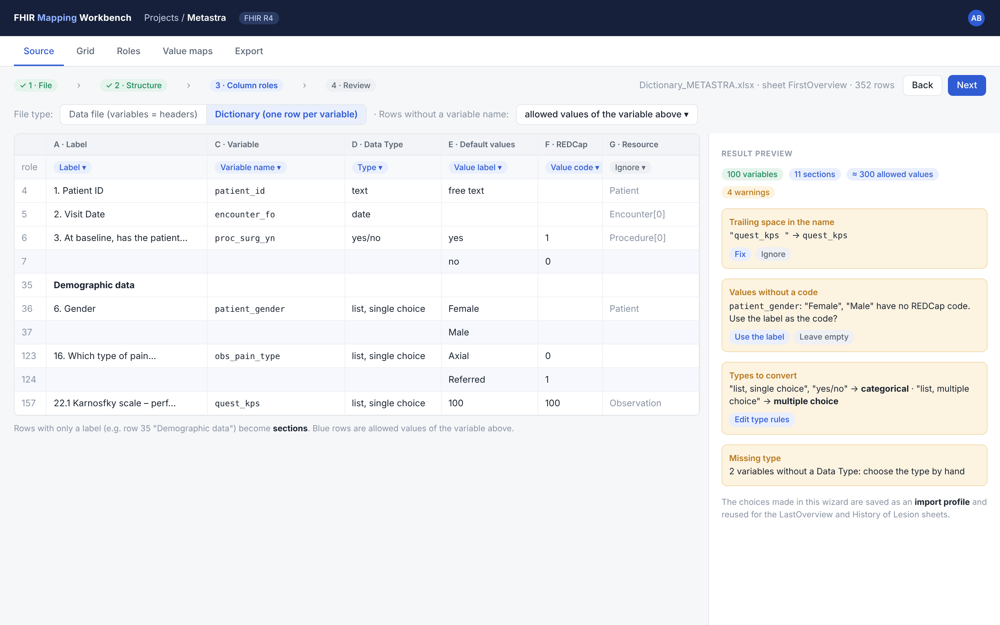

### 2. Manual source editing

After import, the source stays a grid that can be edited by hand. Variables can be added, renamed, merged, split, moved and deleted; types and allowed values can be fixed; variables can be created without a file. Every change shows its impact on the mapping rows. When a variable is renamed, such as `obs_bloodt_lymphocites_spec`, the original name stays as an alias, because that is the name in the data. Features: B6, B7 (V2).

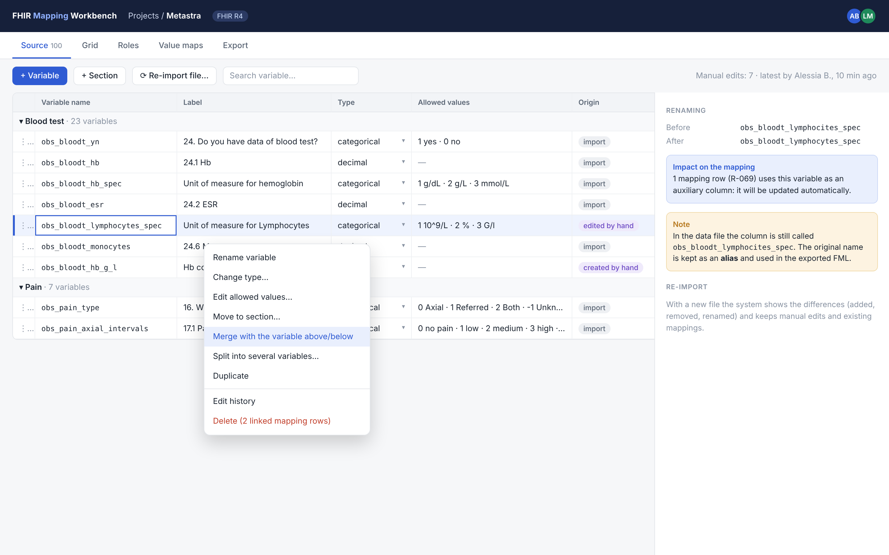

### 3. Mapping grid

The main view. Rows are grouped by source section (Demographic data, Pain, Blood test); a toggle at the top groups them by target role. The Role, Element and Transform columns are filled from menus. The Values column summarises the value map, and a cell with a problem is highlighted in red with the reason. The panel on the right shows the selected row in detail, with comments and history. Features: D1, D2, D5, D7, A5, A6.

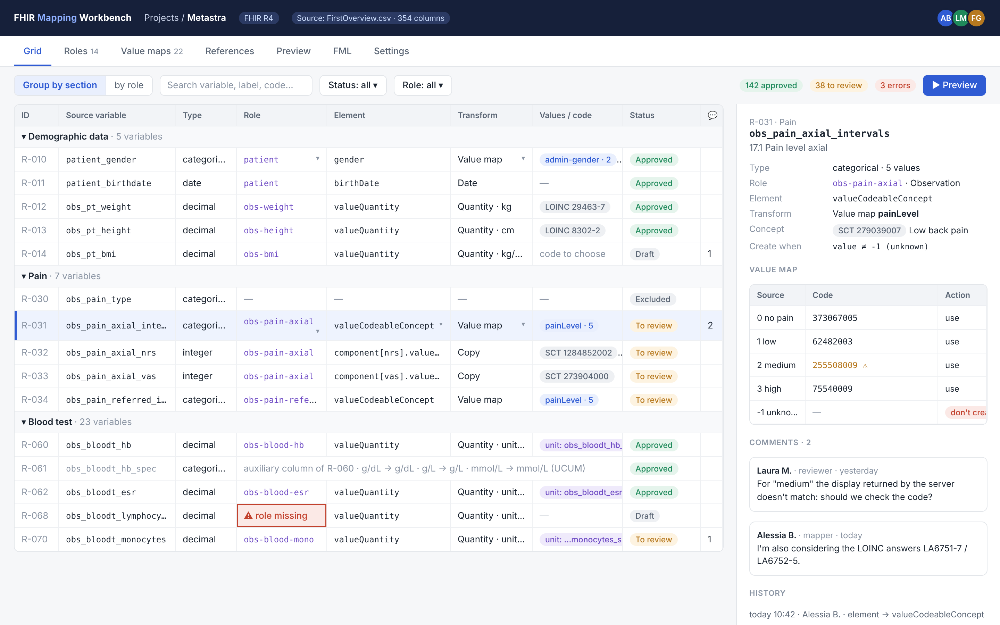

### 4. Value map and code search

Opens from the Values column. On the left are the source values with code, display and action: here "unknown" does not create the resource. On the right the search panel queries BioPortal (LOINC only) and shows system, code and display; codes from other systems, such as SNOMED CT, are entered by hand and stay unverified. One click assigns the code to the selected entry. Features: E1, E2, E4, E6.

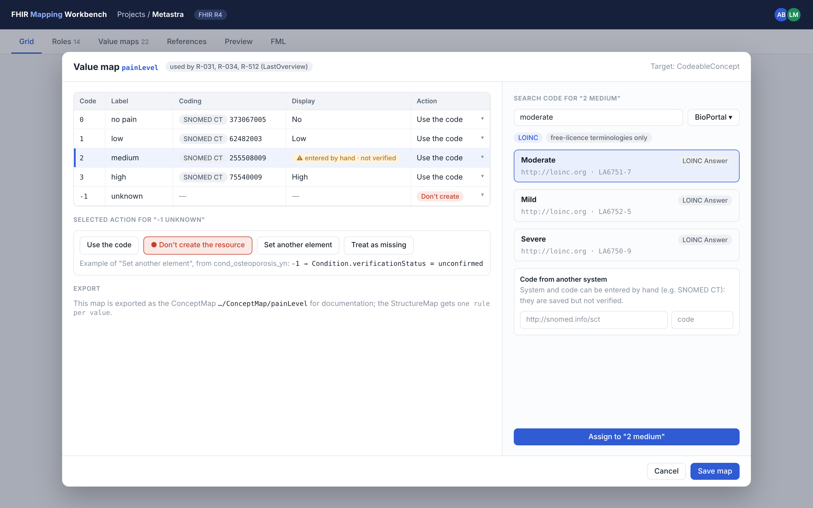

### 5. Path picker

Opens from the Element cell. It shows the Observation R4 tree with types and cardinalities, and can be filtered. Repeated elements such as `component` are added with a name (`component[nrs]`) instead of an index. Features: D3, D4.

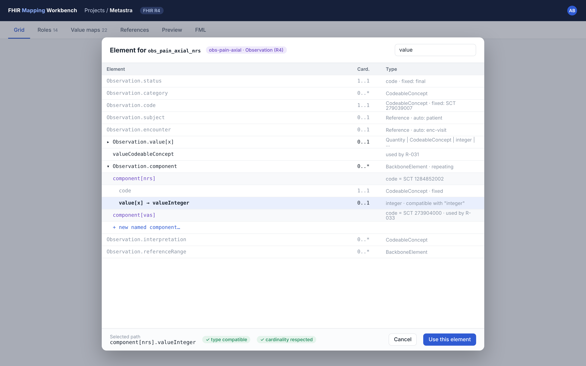

### 6. Roles and references

On the left is the list of declared roles, with multiplicity, context and creation condition. On the right is the reference graph, which replaces the ER diagram drawn by hand in MOTU. Dashed arrows are references filled automatically from the context. Features: C1–C4, F1–F5.

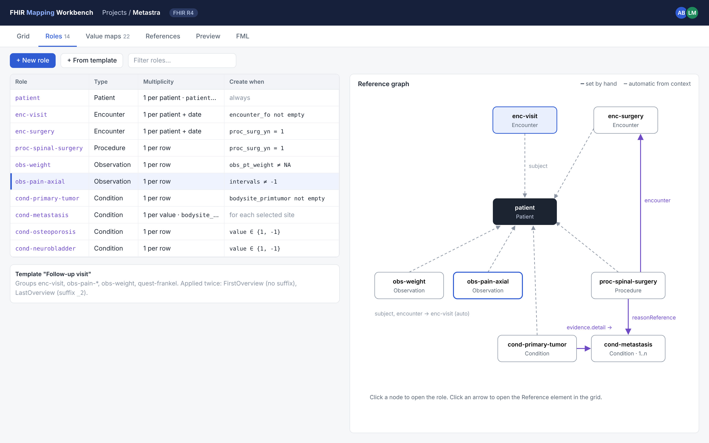

### 7. Preview and validation (V2, separate module)

The user picks a sample row and starts the preview. In the centre is the Bundle generated by Matchbox, on the right the `$validate` results, each linked to the mapping row that produced it. A separate tab shows the generated FML. Features: G4, G5 (V2).

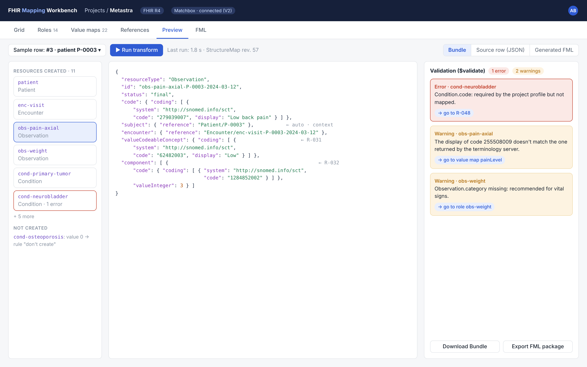

## FML generation and export

Each model object translates into a fixed FML construct, so the user never writes the language. The engineer can still read and check it.

| Model object | Generated construct |
| --- | --- |
| Source | Logical StructureDefinition of the normalized row, plus a normalization specification |
| Role | Dedicated `group` + `create('<Type>')` inside a Bundle `entry`, with `PUT` and `fullUrl` |
| "Per group" multiplicity | Deterministic id computed by the normalization; resources merge on the server thanks to `PUT` |
| Creation condition and "don't create" action | FHIRPath `where` clause on the rule that creates the role's resource |
| Row with a simple transform | Rule `src.column as v -> tgt.element = v` |
| Value map | One rule per value with `cc(…)`, `c(…)` or a constant; ConceptMap exported as documentation |
| "Set another element" action | Rule conditioned on the value (`where ($this = '-1')`) |
| Reference | `reference = 'Type/' + id` computed with `evaluate`, inside the creation condition of the target role |

The complete rules, verified on two examples, are in the "Translation rules" section.

**Excerpt of the verified FML: the Metastra role Observation\[0\] · axial pain.** This is the code run with the HL7 engine on 9 November 2026.

```
group Observation0(source src : FirstOverviewRow, target res : Observation) {
  src -> res.status = 'final' "fixed-status";
  src -> res.code = cc('http://snomed.info/sct', '279039007', 'Low back pain') "fixed-code";
  // R-006: value map painLevel (one rule per value)
  src.obs_pain_axial_intervals as v where ($this = '0') -> res.value = cc('http://snomed.info/sct', '373067005', 'No') "R-006-0";
  src.obs_pain_axial_intervals as v where ($this = '1') -> res.value = cc('http://snomed.info/sct', '62482003', 'Low') "R-006-1";
  src.obs_pain_axial_intervals as v where ($this = '2') -> res.value = cc('http://loinc.org', 'LA6751-7', 'Moderate') "R-006-2";
  src.obs_pain_axial_intervals as v where ($this = '3') -> res.value = cc('http://snomed.info/sct', '75540009', 'High') "R-006-3";
  // component[nrs]: named slice, created only if the column has a value
  src where ($this.obs_pain_axial_nrs.exists()) -> res.component as slc then {
    src -> slc.code = cc('http://snomed.info/sct', '1284852002') "slice-nrs-code";
    src.obs_pain_axial_nrs as v -> slc.value = v "R-007";
  } "slice-nrs";
  src.id_Patient0 as t -> res.subject as r, r.reference = evaluate(t, 'Patient/' + $this) "R-008";
  // R-009: the reference honours the creation condition of Encounter[0]
  src where ($this.encounter_fo.exists()) then {
    src.id_Encounter0 as t -> res.encounter as r, r.reference = evaluate(t, 'Encounter/' + $this) "R-009";
  } "R-009-guard";
}
```

**Export formats (MVP)**

| Format | Content | Use |
| --- | --- | --- |
| FML (zip) | StructureMaps as FML text and JSON, logical model of the normalized row, normalization specification, ConceptMaps, table load order | Input for Matchbox or another FML engine |
| CSV / Excel | One line per mapping row: variable, role, element, transform, codes; value maps in a separate sheet | Documentation and review, in the style of MOTU Table 1 |
| Project (.json) | Complete model: source, roles, rows, maps, references, statuses, comments | Backup, versioning in git, re-import into the workbench |

**Check before export (MVP, G10).** The workbench checks every generated StructureMap against the official grammar, in the backend and without external services. No data is needed and the check takes a few milliseconds.

| Check | In the MVP | When |
| --- | --- | --- |
| Official grammar (`mapping.g4`) | Yes, in the backend | On every export and on demand |
| Compilation with an HL7 engine (Matchbox or validator) | No | V2, with the conversion module |
| Running the maps on the examples | Only in the project's tests, with the HL7 validator (Java) in CI | On every commit |

Project validation, type checking included (Architecture section), catches mapping errors even before generation. The grammar checks the FML text produced. The golden tests in CI check that the translation rules produce the expected Bundles.

**Preview cycle (V2, separate conversion module)**

1. The workbench converts the chosen sample row into JSON conforming to the logical model.
2. It publishes to Matchbox the StructureMap, logical model and ConceptMaps of the current mapping version.
3. It calls `$transform` and gets the Bundle.
4. It calls `$validate` on the Bundle, with the project's version and profiles.
5. It shows Bundle and errors next to the grid. Each error leads to the row ID ("R-042") that appears in the FML rule name.

The conversion module will use the same artifacts exported by the workbench. That is why it can be developed and installed separately, including whole-dataset conversion (G9).

## Non-functional requirements

The most important constraints concern clinical data: the real dataset must never go through the workbench, which works on the dictionary and a few sample rows.

| ID | Area | Requirement |
| --- | --- | --- |
| N1 | Data protection | Only headers, the dictionary and pseudonymised sample rows are loaded into the workbench; a notice at import reminds users. No data is sent to external services except text searches on the terminology server |
| N2 | Installation | Distributed with Docker Compose (application, database, authentication; Matchbox only in V2 with the conversion module), installable on-premise in a hospital or university |
| N3 | Authentication | Login with OpenID Connect (e.g. Keycloak or the institution's identity provider); local accounts only for development |
| N4 | Authorisation | Role permissions checked on the server for every operation |
| N5 | Traceability | Every change recorded with author, date and previous value; the log cannot be edited by users |
| N6 | Performance | Smooth grid up to 2,000 mapping rows; FML export of a project like Metastra (100 variables) in under 5 seconds |
| N7 | Concurrency | At least 10 simultaneous users on the same project without losing changes |
| N8 | FHIR versions | Resource and profile definitions loaded from FHIR packages, not hard-coded in the application; R4 and R5 in the first release |
| N9 | Terminologies | One adapter for several sources; for now only BioPortal and free-licence terminologies (LOINC); API key kept on the server; codes from other systems (e.g. SNOMED CT) are entered by hand without verification |
| N10 | Mapping portability | The intermediate model is documented by a public JSON Schema, independent of the user interface |
| N11 | Usability and language | All frequent operations can be done from the keyboard. The interface is in English; every string goes through i18n, so an Italian translation can be added without code changes |
| N12 | Browsers | Latest two versions of Chrome, Edge and Firefox, screens from 1366 px wide |
| N13 | Backup | Daily database backup and full export of a project to a file |
| N14 | Software licence | To be decided; Apache-2.0 is proposed. An open-source release would ease adoption in other research projects and sponsorship |

## Project JSON Schema

The project file (H3) is a single JSON document, described by a JSON Schema draft 2020-12 (`mapping-project.schema.json`, format 1.3.0). It is the source of truth: the grid edits it, and the FML generator and the CSV export read it. The schema and an example with 11 Metastra variables were checked with the Ajv validator.

| Key | Content | Features |
| --- | --- | --- |
| `project` | Name, description, FHIR version (4.0.1 or 5.0.0), packages, base of the canonical URLs, allowed terminologies (the API key stays on the server), conversion output (`fullUrlBase`, `onInvalidValue`) | A1, E2 |
| `sources[]` | Tables: row key, import profile, sections, columns with name, original alias, type, date format, decimal separator, semantic description, allowed values, missing values | B1–B6, B11 |
| `sourceRelations[]` | Links between tables through key columns; empty with a single table | B11 |
| `instances[]` | Roles: `resourceType` + `index` (visible key `Condition[1]`), label, description, multiplicity, context, creation condition, id rule, named slices, fixed values | C1–C6, D4 |
| `mappings[]` | Rows: code `R-nnn`, column (absent for constants and references), role, path, transform, condition, notes | D1–D8, F1–F3 |
| `valueMaps[]` | Reusable maps: entries with source value, Coding or value, action | E1–E6 |
| `templates[]` | Groups of roles with parameters and applications (e.g. suffix `_2`) | C7 |
| `extensions` | Free space for external modules, ignored by the generator | V2, group I |

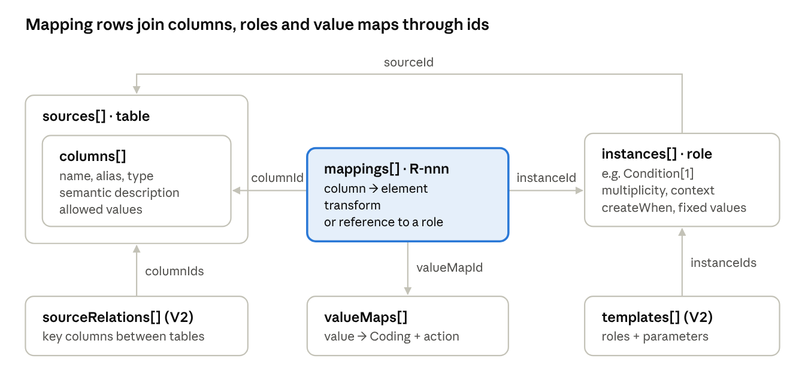

Each arrow is an `…Id` field that points to the internal id of another object. The mapping row is where source, role and codes meet.

**Main choices**

- **Stable internal ids.** Every object has a generated `id` that never changes. All links use these ids, so renaming a column or a role breaks nothing. Visible names (`R-031`, `Condition[1]`) are derived.
- **Renamed column, still readable.** `name` is the corrected name, `originalName` the one in the data, used by the FML.
- **Multiplicity per record.** `perRow`, `perGroup` (with the grouping columns) or `perValue`. It describes how many resources a role produces for each converted record, not in total.
- **Conditions and actions as data.** `createWhen` uses guided operators (`notEmpty`, `equals`, `in`, `and`, `or`, `not`); the FHIRPath `expression` operator is reserved for experts. Value actions are `use`, `skipInstance`, `setElement` and `absent`.
- **Codes with a verification result.** Each Coding carries `verification.status`: `verified`, `displayMismatch`, `notFound` or `manual`, for SNOMED CT codes entered by hand.
- **References as a transform.** A row without a column and with `transform.kind = reference` points to another role. `auto: true` marks references generated from the context, `via` the table relation to use.
- **Ready for the AI assistant.** `provenance.kind = ai` marks the assistant's proposals, which enter with status `draft`.

**Behaviour rules (decided on 9 November, format 1.1.0)**

| Topic | Rule |
| --- | --- |
| Unit of conversion | Each source record produces one `transaction` Bundle; each resource is written with `PUT` on its deterministic id. `perGroup` resources thus merge on the server, because the StructureMap sees one row at a time. If two records write different fields of the same resource, the last one wins: the grid flags `perGroup` roles fed by several rows. |
| Resource ids | Fixed parts stay readable; column values become a truncated SHA-256 hash (24 characters by default), e.g. `cond-osteoporosis-3f9a…`. The `sanitize` option produces readable ids by replacing disallowed characters. The final id respects the FHIR limit: letters, digits, `-` and `.`, at most 64 characters. |
| References | The id of the referenced resource is computed by applying the target role's `idRule` to the current record. The rule's columns must be in the same table or reachable through `via`. A reference to a `perValue` role is allowed only from a repeating element (one reference per generated resource), never from a single element. |
| Resource creation | A resource is created if `createWhen` is true (absent = always) and no column mapped to the role has a value whose action is `skipInstance`. The grid shows the resulting condition in plain words. |
| Repeating elements | Without a slice, all rows that touch a repeating element write into the same repetition. Several repetitions need a named slice. |
| Data formats (format 1.3.0) | Inside the platform every value has one canonical form: ISO dates, `.` decimals, `true`/`false`. Local formats are declared on the column, at the border: `dateFormat` (e.g. `dd/MM/yyyy`) and `decimalSeparator` (`.` or `,`, e.g. `11,20`). The separator is strict and there are no thousands separators: with `,` a `.` is invalid (`1.234` in Italian data is one thousand two hundred thirty-four, never 1.234), and with `.` a `,` is invalid. Booleans written as words (`Sì`/`No`) are a `categorical` column with a value map to `boolean`; a `boolean` column accepts only the canonical forms. The data file's delimiter, quote, encoding and header row describe the file, not the mapping: the conversion module receives them at run time. `project.output.onInvalidValue` decides what happens to a value that cannot be converted: `fail` (default) stops the conversion and reports it, `report-drop` omits and reports it, `reject-row` discards the row and reports it. |
| Multiple choices | The column declares how the value appears in the data: `delimited` (e.g. `1,3,5` with a separator) or `expanded` (one 0/1 column per value, V2). A row with `repeat: eachValue` writes one repetition per value, e.g. `Procedure.bodySite` for each level of `proc_surg_loc`. |

**Rules the schema cannot express**, checked by the application on import and on save:

1. Every id is unique in the file, and every `…Id` field points to an existing object of the right kind.
2. The pair `resourceType` + `index` is unique; the same holds for the `R-nnn` codes.
3. A row and its role belong to the same table, except references with `via`.
4. `path` exists in the StructureDefinition of the chosen FHIR version, and the slices used in the path are declared in the role.
5. A reference points to a role whose type is allowed by the element's `targetProfile`; the columns of the target `idRule` are reachable; towards a `perValue` role the source element is repeating.
6. A value map and the columns that use it agree. Only `categorical`, `multipleChoice` and `boolean` columns can use a value map (code `VALUE_MAP_COLUMN_TYPE_NOT_ALLOWED`, error on the row: declare the column categorical). A `categorical` or `multipleChoice` column used by a value map must have allowed values (normalization 1.2.0, code `VALUE_MAP_COLUMN_WITHOUT_ALLOWED_VALUES`, error): the normalization rejects a value outside the list, so no value reaches the map without a rule and is lost silently. The `sourceValue`s of the map are allowed values or missing-value codes of the column (`VALUE_MAP_SOURCE_VALUE_UNKNOWN`). Every allowed value that is not a missing value has an entry in each value map that uses the column, with a code or an action (`skipInstance`, `setElement`, `absent`); values are compared after NFC and trim, case-sensitive (code `VALUE_MAP_INCOMPLETE`, error).
7. Generated ids respect the FHIR limit of 64 characters, fixed parts included.
8. `repeat: eachValue` is used only with `multipleChoice` columns and towards repeating elements.
9. The allowed values of a column fit its declared type (format 1.3.0, code `ALLOWED_VALUE_TYPE_MISMATCH`, error): `boolean` only in the canonical forms (`true`/`false`, `1`/`0`, `yes`/`no`, `y`/`n`, case-insensitive), so `Sì`/`No` needs a `categorical` column with a value map to `boolean`; `integer` an integer; `decimal` a number with the column's `decimalSeparator` (strict: `1.234` does not fit a `,` column); `date` and `dateTime` a valid date that matches `dateFormat`. Values listed in `missingValues` are ignored. The check uses the same parsers as the normalization, so a value accepted here is a value the conversion accepts. A `categorical` or `multipleChoice` column with a list must keep at least one allowed value once missing values are removed (normalization 1.2.0, code `ALLOWED_VALUES_EMPTY`, error), because an empty list would reject every value.

**Example: the role Condition\[1\] · osteoporosis** (excerpt of the example file)

```json
{
  "id": "ins_cond1", "resourceType": "Condition", "index": 1, "label": "osteoporosis",
  "sourceId": "src_firstoverview",
  "multiplicity": { "kind": "perRow" },
  "context": { "patientInstanceId": "ins_patient0", "encounterInstanceId": "ins_encounter0" },
  "createWhen": { "op": "in", "columnId": "col_osteo_yn", "values": ["1", "-1"] },
  "idRule": { "parts": [ { "literal": "cond-osteoporosis" }, { "columnId": "col_patient_id" } ] },
  "fixedValues": [ { "path": "code", "value": { "type": "CodeableConcept",
      "coding": { "system": "http://snomed.info/sct", "code": "64859006", "verification": { "status": "manual" } } } } ]
}
```

Row `R-011` links `cond_osteoporosis_yn` to `verificationStatus` with the `osteoStatus` map: 1 → confirmed, -1 → unconfirmed, 0 → `skipInstance`. It is the rule that the Metastra sheet wrote in words ("I don't create the Condition").

**Known limits, deferred to minor versions of the format.** None of them blocks the FML generator.

| Limit | Example in Metastra | Planned solution |
| --- | --- | --- |
| Resources created once and fixed references | Charlson Questionnaire, hospital Organization, local CodeSystems | Multiplicity `once` and a constant value of type Reference or canonical |
| Types built from several columns | Period with start and end from two columns; Range for the DEXA T-score classes | `period` and `range` transforms; value maps towards Range |
| Verbose QuestionnaireResponse | Charlson and Frankel as QR | Already expressible with nested slices on `item` (identified by `linkId`); needs a dedicated helper |
| FHIR version change | `Encounter.class` changes type between R4 and R5 | A check that flags the rows to review when the version changes |
| Under-specified templates | Suffix `_2` of LastOverview | Define parameters and substitutions together with C7 (V2) |
| Values computed from several columns | BMI, Charlson total score | Expert expression or derived columns (B10) |

**Format version.** `formatVersion` follows semver. Compatible additions change the minor; an incompatible change bumps the major and requires an automatic migration when old files are opened.

## Translation to FML: validity and coverage

Generated FML counts as valid if it passes three automatic checks on every export: construction from an AST, parsing with the published ANTLR grammar and compilation with the HL7 reference engine. That it does what the mapping says is guaranteed by the generator tests, until the conversion module (V2) allows previews on real data.

In the R5 specification FML has maturity 0 (Draft) and status Trial Use, and some behaviours (the target list modes) are still marked TODO ([FHIR R5, Mapping Language](https://hl7.org/fhir/R5/mapping-language.html)). The grammar `mapping.g4` is published both in the specification and in the Mapping Language IG, which is under continuous development (version 0.1.0, [build](https://build.fhir.org/ig/HL7/mapping-language-ig/en/mapping.g4)). That is why the practical reference is the HL7 parser used by Matchbox, and the grammar must be pinned to an exact version.

**Levels of assurance**

| Level | What it guarantees | How | When |
| --- | --- | --- | --- |
| 1. Construction | Deterministic output; identifiers and strings always written correctly | The generator builds a typed syntax tree (TypeScript) and prints it; no string concatenation; stable ordering, no timestamps in the code | Always |
| 2. Syntax | The FML follows the grammar | Parsing the output with `mapping.g4` compiled to TypeScript (ANTLR4), inside the backend, without Java | On every export and in the tests |
| 3. Compilation | Types, elements, groups and references resolve against the logical model and StructureDefinitions | HL7 reference parser and compiler | In the project's tests (HL7 validator in CI); on every export in V2 with Matchbox |
| 4. Behaviour | The produced Bundle matches the mapping | "Golden" tests: for each construct a test project, sample rows, transform, comparison with the expected Bundle and validation. Plus generative tests: random projects that are valid for the schema, with a fixed seed, must pass levels 2 and 3 | In CI; per project with the V2 module |

**Coverage: the workbench uses a deliberately chosen subset of FML.** FML is also designed for FHIR ↔ FHIR conversions, bidirectional maps and type rules, which tabular sources do not need. The generator produces only known, tested constructs; the rest stays reachable through the expert expression (D6), which is inserted as is but still goes through levels 2 and 3.

| FML construct | Use in the workbench |
| --- | --- |
| `map`, `uses` source and target | Generated: logical model of the normalized row → Bundle; map name between backticks |
| `///` metadata lines | Not generated (rejected by the HL7 7.0.5 parser) |
| `uses` queried and produced, `imports` | `produced` for every created type; `imports` is a candidate for templates |
| `group` with source and target parameters | Generated: one main group per table, one per role |
| `extends`, default groups `<<types>>` and `<<type+>>` | Not used (they serve FHIR ↔ FHIR conversions) |
| Source rule: element, alias, `where` | Generated from `createWhen`, row conditions, `skipInstance` actions, value maps |
| Source rule: type filter, cardinality, `default`, list mode, `check`, `log` | Not used: checks are done by the workbench and by the normalization |
| Target rule, variables, dependent rules (`then`) | Generated |
| Target list modes (`first`, `share`, `last`, `single`) | Avoided because still TODO in the specification: a shared repetition is created once and filled in a nested rule |
| Transforms `create`, `copy`, `c`, `cc`, `evaluate` | Generated |
| `translate` | Not used: it loses the display and needs a terminology server (see "What the verification revealed") |
| `cast`, `qty`, `reference`, `append`, `uuid`, `id`, `cp`, `truncate`, `escape`, `pointer`, `dateOp` | Not used in the MVP; `dateOp` has undocumented parameters |
| ConceptMap embedded in the map | Not used: ConceptMaps are exported separately as documentation |

**What standard FML cannot do: row normalization.** Three pieces of the model cannot be computed reliably inside a StructureMap: hashed ids (FHIRPath has no hash functions), dates in local formats such as `dd/MM/yyyy`, and missing values such as `NA`. The solution is a deterministic normalization step before the StructureMap, which turns each CSV row into typed JSON conforming to the logical model: ISO dates, multiple choices as arrays, missing values removed, columns renamed to the corrected name, ids already computed in dedicated fields. The normalization specification is derived from the schema (`dateFormat`, `decimalSeparator`, `missingValues`, `multiValue`, `originalName`, `idRule`, `output.onInvalidValue`) and exported with the FML; the conversion module runs it. The advantage is that the FML stays simple and each part can be checked on its own.

## Translation rules (verified on Metastra and MOTU)

The rules were applied by hand, the way the generator will apply them, to two examples: Metastra (one table, 6 roles, 11 variables) and MOTU (three tables with references between them). On 9 November 2026 the 4 resulting StructureMaps passed every check: official grammar `mapping.g4` (IG commit `8bb04b4`), HL7 parser and engine (validator 7.0.5, library `org.hl7.fhir.core`) and R4 validation of the produced Bundles, with 0 errors. The remaining warnings are about good practice (Observations without a date or performer, resources without a narrative) and a UCUM unit that cannot be checked without a terminology server.

| Model element | Generated FML |
| --- | --- |
| Source table | One StructureMap: `uses` of the normalized-row logical model as source and of Bundle as target; main group with `bundle.type = 'transaction'` |
| Role | Rule in the main group `src where (condition) -> bundle.entry as e, e.resource = create('Type') as res, e.request as req then { … }` + a `group` dedicated to the role |
| Id, request, fullUrl | `src.id_Type0 as i -> res.id = i, req.method = 'PUT', req.url = evaluate(i, 'Type/' + $this), e.fullUrl = evaluate(i, '<fullUrlBase>/Type/' + $this)` |
| Creation condition | FHIRPath with `$this.` in front of every column: `notEmpty` → `$this.col.exists()`; `equals` / `in` → `$this.col.where($this = 'v').exists()`; `notEquals`, `notIn` and `skipInstance` → `.where(…).empty()`; then `and`, `or`, `not` |
| Fixed value | `src -> res.element = 'value'`, or `c(…)` for Coding and `cc(…)` for CodeableConcept |
| Copy | `src.col as v -> res.element = v` (a normalized date is also copied into dateTime) |
| Several rows on the same complex element | One shared block, created if at least one column has a value: `src where ($this.a.exists() or $this.b.exists()) -> res.period as p then { … }` |
| Named slice | `src where ($this.col.exists()) -> res.component as slc then { discriminator with cc(…); value }` |
| Value map | One rule per value: `src.col as v where ($this = '1') -> res.value = cc(system, code, display)`; a constant for codes and booleans. Each rule is named `<row code>-<value>`, with characters outside `[A-Za-z0-9_.-]` replaced by `_` (`R-006-1`, `R-011--1`, `Sì` → `R-002-S_`); when two values of the same map get the same name, the later ones in entry order get a numeric suffix (`Sí` → `R-002-S_2`, `N A` after `N/A` → `R-002-N_A2`). ConceptMaps are exported only as documentation |
| Quantity with unit from a column | `res.value = create('Quantity') as q then { value; one rule per unit with unit, system and code }` |
| Multiple choice, `repeat: eachValue` | The normalization produces a list; each per-value rule fires for every item, so one repetition per selected value |
| Reference in the same table | `src.id_Target as t -> res.subject as r, r.reference = evaluate(t, 'Type/' + $this)`, inside the creation condition of the target role |
| Reference to another table (`via`) | Same form; the id is computed by the normalization with the columns given by the relation; the target resource must already be loaded |

**What the verification revealed.** Six problems were not visible from reading the specification, and each became a generator rule.

| Problem | How it showed up | Rule adopted |
| --- | --- | --- |
| Map name | The grammar wants an identifier (`= FirstOverview`), the HL7 parser a string (`= "FirstOverview"`): neither form passes both | Name between backticks (`` = `FirstOverview` ``), the only form both accept |
| `/// url = …` metadata lines | Allowed by the grammar, rejected by the HL7 7.0.5 parser | Not generated: metadata lives in `map` and in the StructureMap JSON |
| Missing `fullUrl` | 19 validation errors: relative references do not resolve inside the Bundle | `fullUrl` always present; base in `project.output.fullUrlBase` (schema 1.2.0) |
| `translate()` | The display of the codes is lost; with output `display` it returns nothing without errors; the command-line validator does not run maps with `translate` without a terminology server | One rule per value with the complete code; no dependency on a terminology server during conversion |
| Columns starting with a capital letter | In MOTU `where (AdmissionDate.exists())` was always false: FHIRPath reads the name as a type. Encounter and fall were missing, with no errors | `$this.` prefix in front of every column in expressions |
| References across tables | Each Bundle validated alone gives errors; the three merged give 0 errors | The export declares the load order derived from the relations: MotuPatient → HospitalStay → Fall |

Two of these problems (the empty `translate` and the capitalised columns) produce wrong results without any error. This is why verification level 4, the behaviour tests, is essential for the generator.

**Golden cases cover shapes and features, not datasets.** Each golden case is chosen for a data shape (wide, long, several related tables, large volume, locale) or a translation feature that the existing cases do not cover. A proposal for a new golden case says which shape or feature it adds.

**Reproducibility.** The `fml-examples` package contains projects, maps, logical models, ConceptMaps, normalization specifications, test rows, produced Bundles, the pinned grammar and the prototypes used for verification. These prototypes become the golden tests of the TypeScript generator.

## Generator contract

For each table the generator produces artifacts described by their own schemas, so the conversion module (V2) can run them without knowing the workbench. On 9 November 2026 the contract was verified on Metastra and MOTU: 7 checks out of 7 passed, negative cases included.

| Artifact | Format | Produced by | Used by |
| --- | --- | --- | --- |
| Project file | `mapping-project.schema.json` 1.3.0 | Workbench | Generator, export |
| Normalization specification | `normalization.schema.json` 1.2.0 | Generator | Conversion module |
| Logical model of the normalized row | `logical` StructureDefinition | Generator | FML engine |
| StructureMap | FML, plus JSON compiled by the HL7 engine | Generator (syntax tree → printer) | FML engine |
| ConceptMap | FHIR resources | Generator | Documentation and reuse |
| Package manifest | `manifest.schema.json` 1.0.0 | Export (G7) | Conversion module |

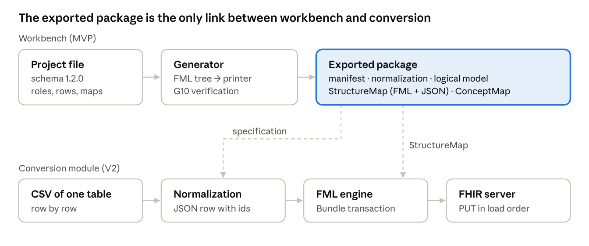

The conversion module reads only the package: the normalization specification to prepare each row, the StructureMap to produce the Bundle, the manifest for the table order.

**Normalization: what happens to each cell.** The algorithm is fixed in the schema, so two implementations produce the same JSON byte for byte. The reference implementation is `@cindermed/normalizer` (ADR-0010), kept byte-identical to `tools/normalize.mjs` by a differential test. It works row by row on a stream of chunks, so memory does not grow with the number of rows, and can write NDJSON, one row per line. The data file is decoded as the WHATWG Encoding Standard says: `iso-8859-1` is read as windows-1252 (0x80 is `€`), and UTF-8 drops a leading byte order mark.

1. Unicode NFC and removal of outer spaces.
2. Empty cell or value in `missingValues` → element omitted.
3. Multiple choice: split on the separator, empty parts dropped, duplicates removed, order kept.
3b. Allowed values (format 1.2.0): for `categorical` and `multipleChoice` columns the specification lists the allowed values (`allowedValues`, missing values left out). Each value, or each part of a multiple choice, must be in the list, compared after step 1 and case-sensitive (`sì` is not `Sì`); otherwise it is an invalid value and step 5 applies. A column without allowed values is not checked.
4. Conversion by type: integers without leading zeros; decimals with `decimalSeparator` (comma too) and digits kept (`11,20` → `11.20`), the separator strict and no thousands separators (with `,`, `1.234` and `1.234,5` are invalid values; with `.`, `1,234` is); booleans in the canonical forms (`true`/`false`, `1`/`0`, `yes`/`no`, `y`/`n`, case-insensitive; the generator never writes `trueValues`/`falseValues`, and words such as `Sì`/`No` go through a value map); dates according to `dateFormat` (`yyyy`, `MM`, `dd`, `HH`, `mm`, `ss`) with a calendar check (`31/02/2023` is rejected), year-only and year-month included.
5. Value that cannot be converted → `onInvalidValue`, taken from `project.output.onInvalidValue`: `fail` (the project default) stops the conversion at the first such value and reports it; `report-drop` omits it and reports it; `reject-row` discards the row and reports it. (The normalization schema's own default, for specifications that omit the field, stays `report-drop`.)
6. Id: SHA-256 (or HMAC with a key kept outside the package) over the already normalized values, joined by U+001F; result = fixed parts + the first 24 hex characters. If a column of the id is missing, the id is not computed and the role is not created.

**Element names.** The element name in the logical model and in the FML comes from the column name. Characters outside `[A-Za-z0-9_]` become `_`; the prefix `c` is added if the name does not start with a letter, and a trailing `_` for the four words the grammar rejects. Examples: `log` → `log_`, `Pain level (0-10)` → `Pain_level__0_10_`, `2nd visit` → `c2nd_visit`. The original name stays in `sourceName` to read the data file.

**Manifest and load order.** The manifest lists tables, maps, logical models, normalization specifications, ConceptMaps, versions (schema, FHIR, grammar, engine) and the verification result. It also lists every file with its SHA-256 digest, to detect changes. A table depends on another if one of its rows uses a `via` relation towards it. The order is a topological sort by levels (alphabetical on ties), and a cycle between tables blocks the export. For MOTU the result is `MotuPatient → HospitalStay → Fall`.

**FML syntax tree** (`generator/fml-ast.ts`). The generator can build only these nodes:

| Node | Variants |
| --- | --- |
| Map | url, name, `uses` (source, target, produced), groups |
| Group | name, at least two parameters, rules |
| Rule | one source (element, alias, `where`), element targets, `then` with nested rules or a group call |
| Transform | `literal`, `copy`, `create`, `c`, `cc`, `evaluate` |
| FHIRPath expression | `exists`, `anyOf`, `noneOf`, `thisEquals`, `and`, `or`, `not`, `prefixThis`; `raw` only for the expert expression (D6) |

Names (groups, variables, rules) are branded types: they can only be obtained from constructors that reject disallowed values. The printer (`fml-print.ts`) is deterministic: map name between backticks, strings between single quotes with escaping, `$this.` in front of every column, parentheses only around nested `and`/`or`, 2-space indentation, no `///` metadata. Proof: the tree of the MOTU HospitalStay map passes `tsc --strict`; printed, it is byte-identical to the verified map file and passes every check.

**New rules found while building the contract**

| Problem | How it showed up | Rule |
| --- | --- | --- |
| Different ids for the same resource | With the hash over raw text, a date written `03/09/2023` in one table and `2023-09-03` in another would give two Encounters | Hash over normalized values: tested, same id with both formats |
| Resource without an id | Fall row with `AdmissionDate` = `31/02/2023`: date discarded, id not computable, but the `FallDate` present would have created the fall with no id or request | Every role's creation condition always includes the presence of its id: now the row produces no resources |
| Reserved words | Of 16 reserved words tried as element names, the HL7 parser accepts all; the official grammar rejects `share`, `default`, `log`, `then`. Backticks do not help: the HL7 parser keeps them in the name | Element-name rule (above); `target`, `source`, `group` and the others are written as they are |
| Multiple choices across several columns | The project schema allows `expanded` (V2), the normalization does not | The export explicitly rejects `expanded` until B9 is implemented |

**What is left to write the generator.** The missing piece is the project → syntax tree function, that is, the already verified translation rules written in TypeScript. The prototype normalizer (JavaScript) is the reference for the conversion module. The suite `tests/run-all.sh` and the files in `fml-examples` become the golden tests.

## Architecture

The workbench is a TypeScript monorepo with a React web app, a Node API, PostgreSQL and Keycloak, started with Docker Compose; Matchbox joins in V2 with the conversion module. The domain logic (model, FHIR definitions, FML generator, export) lives in shared packages: the API runs them, and the browser reuses the same packages for immediate validation.

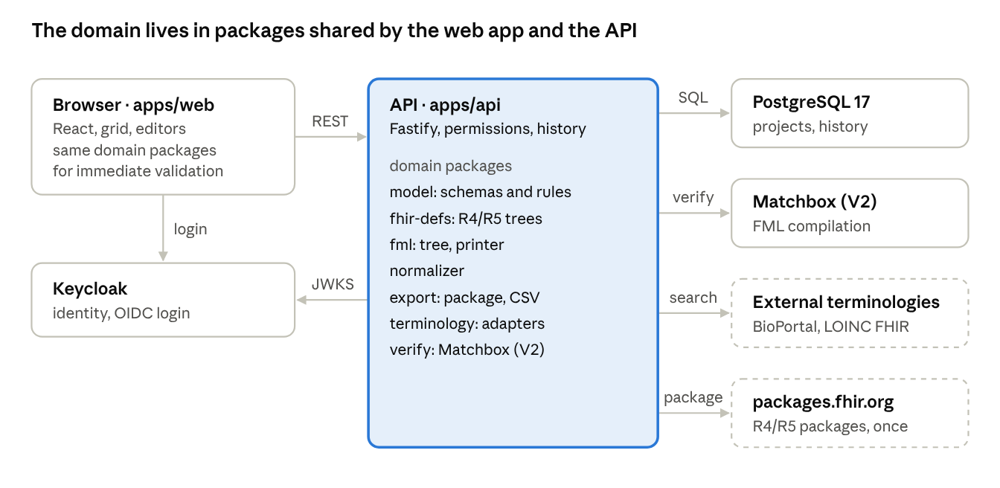

The API is the only part that talks to the database, Matchbox and external services; the browser receives only project data and results.

### Stack

| Area | Choice | Reason |
| --- | --- | --- |
| Language | TypeScript in strict mode everywhere, Node.js LTS (22 or later) | One language; model types shared between client and server |
| Monorepo | pnpm workspaces | Separate domain packages that can be tested on their own |
| Frontend | React 19 + Vite, React Router, TanStack Query, Mantine (components), i18next (English; Italian added as a translation) | Mature MIT libraries, with ready-made comboboxes and modals |
| Grid | TanStack Table + TanStack Virtual, grouping and cell editors written in the app | AG Grid Community excludes row grouping, which is only in the paid Enterprise edition ([AG Grid](https://www.ag-grid.com/javascript-data-grid/community-vs-enterprise.md)); D2 needs it |
| API | Fastify 5, validation with Ajv on the same JSON Schemas as the model, generated OpenAPI | The schemas already defined become the API contract |
| Database | PostgreSQL 17, Kysely (typed queries) and SQL migrations | JSONB for project objects, transactions, history |
| Authentication | Keycloak 26 (OIDC, authorization code with PKCE); the API verifies JWTs with the realm's public key | Already planned; can be integrated with the institution's identity provider |
| FHIR definitions | Packages `hl7.fhir.r4.core` 4.0.1 and `hl7.fhir.r5.core` 5.0.0 (plus any IGs) from packages.fhir.org, cached on a volume | Element trees without network access on every use |
| FML grammar | The IG's `mapping.g4` (commit `8bb04b4`) compiled to TypeScript with antlr-ng | Syntax check in the backend, without Java |
| FML verification (G10) | In the MVP only the official grammar in the backend; Matchbox in V2, with the conversion module | No extra service to run in the MVP |
| Export | ExcelJS (xlsx), streaming zip library | Packages and sheets generated on the server |
| Documentation site | Astro Starlight in `apps/docs` | Markdown pages next to the code, versioned docs, built-in i18n for a later Italian translation |
| Tests | Vitest, fast-check (generative tests with a fixed seed), Playwright (end-to-end) | Unit, golden and end-to-end in the same pipeline |

### Repository layout

The application lives in one monorepo, `workbench`, in the CinderMed GitHub organization (see "GitHub organization and repositories" and ADR-0001 under Development process).

```
workbench/
  apps/
    web/                 React: pages, grid, editors, API calls
    api/                 Fastify: authentication, permissions, persistence, import, export, verification
    cli/                 `cindermed` command (validate, export); published to npm with the domain packages
    docs/                user documentation site (Astro Starlight): guides, worked examples, reference
  packages/
    model/               JSON Schemas (project 1.3.0, normalization 1.2.0, manifest), generated types, integrity rules
    fhir-defs/           loading R4/R5 packages, element tree, path resolution
    fml/                 syntax tree, printer, project → FML generator, grammar check
    normalizer/          reference normalizer (port of tools/normalize.mjs)
    export/              FML package + manifest, CSV/Excel, project JSON
    terminology/         BioPortal and FHIR terminology server adapters
    verify/              (V2) Matchbox and HL7 validator adapters
  fixtures/
    fml-examples/        verified package: projects, maps, expected Bundles (golden tests)
    excel/               the MOTU and Metastra spreadsheets
  docker/                compose, development Keycloak realm, Matchbox configuration (V2)
  docs/                  this specification (specification.md), architecture decision records (adr/)
  CLAUDE.md
```

### FHIR definitions engine (`packages/fhir-defs`)

Given a project (FHIR version and packages), the engine loads the StructureDefinitions with snapshots and answers four questions:

| Function | Result | Used by |
| --- | --- | --- |
| `resourceTypes()` | Resource types of the version | Role creation (C1) |
| `elementTree(typeOrProfile)` | Nodes with path, cardinality, types, `targetProfile`, fixed or pattern values, profile slices; complex datatypes (e.g. `period`) expand on request | Path picker (D3) |
| `resolvePath(typeOrProfile, path, slices)` | The element found, with type and cardinality, or the error | Inline validation (D7) |
| `referenceTargets(typeOrProfile, path)` | Resource types allowed for a Reference | Reference choice (F1, F4) |

Rules: choice types `value[x]` are exposed with their concrete name (`valueQuantity`, `valueCodeableConcept`); a named slice (`component[nrs]`) is allowed only on elements whose maximum cardinality is greater than 1; FHIR extensions cannot be mapped in the MVP. Trees are kept in memory per version-type pair; packages sit on a volume and are downloaded only the first time.

### Project validation

Validation runs in the API on every save (on the changed object and on those that depend on it) and on the whole project before export. The same packages run it in the browser for immediate feedback.

| Level | Checks | Severity |
| --- | --- | --- |
| Schema | Project JSON Schema (Ajv) | Error |
| Integrity | The 9 rules listed in the JSON Schema section (ids, internal references, uniqueness, `via`, `repeat`, id length, allowed values that fit the column type) | Error |
| FHIR | Existing path, type compatible with the transform, cardinality, type allowed for References, declared slices | Error |
| Quality | Columns without a description, columns neither mapped nor excluded, roles without rows, `perGroup` roles fed by several rows, `manual` codes or codes with a different display, `categorical` or `multipleChoice` columns without allowed values and not used by a value map (`ALLOWED_VALUES_MISSING`: values will not be checked during conversion) | Warning |

Every result has the shape `{severity, code, objectKind, id, field, message}`. Codes are stable (e.g. `PATH_NOT_FOUND`, `TYPE_MISMATCH`, `REF_TARGET_NOT_ALLOWED`), so the grid highlights the right cell. Errors block the export, warnings do not.

### Type compatibility in the grid

A row is valid only if its transform produces a value of the target element's type. Example: a boolean column copied to `Patient.name` is an error, because `name` is a HumanName and a yes/no value cannot become a name; on `Patient.active`, which is a boolean, the same column is valid.

The check acts at three moments:

1. **In the path picker**: only elements compatible with the chosen column and transform can be selected; the others stay visible in grey, with the reason.
2. **In the grid**: if the column, element or transform changes later, the cell turns red and the message proposes a fix (a sub-element or a suitable transform).
3. **On export**: type errors block the export like the other validation errors.

**Direct copy** (`transform.kind = copy`)

| Column type | Allowed FHIR elements | Allowed with a warning | For other types |
| --- | --- | --- | --- |
| `string` | string, markdown | code, id, uri, url, canonical (the value must match their format; see binding) | Error |
| `integer` | integer | positiveInt, unsignedInt (an out-of-range value gives an invalid resource); decimal | Error |
| `decimal` | decimal | — | Error (integer would lose the decimals) |
| `boolean` | boolean | — | Error: writing it as a code or text needs a value map. A `boolean` column holds only canonical forms (rule 9); words such as `Sì`/`No` are a `categorical` column |
| `date` | date, dateTime | — | Error (instant needs time and time zone) |
| `dateTime` | dateTime | — | Error |
| `categorical` | — | code and string, only if the column's values are fine as they are (see binding) | Error: a value map is needed |
| `multipleChoice` | — | — | Error: a value map with `repeat: eachValue` is needed |

**Transforms and the types they produce**

| Transform | Allowed columns | Allowed FHIR elements |
| --- | --- | --- |
| Value map | categorical, multipleChoice, boolean (other types are a rule 6 error: declare the column categorical) | The map's target type (`code`, `Coding`, `CodeableConcept`, `boolean`) must match the element's type. A map to `boolean` turns local yes/no words into `true`/`false` (golden case `boolean-value-map`: `Sì`/`No` → `Observation.valueBoolean`) |
| Quantity | integer, decimal | Quantity and its profiles (SimpleQuantity, Age, Duration) |
| Conversion (`cast`) | integer → decimal, date → dateTime, any type → string | The conversion's result type |
| Concatenation | string, code, integer, decimal | string, markdown |
| Constant | none | The type of the fixed value (`FhirValue.type`) must match the element's type |
| Reference | none | Reference, if the target role's type is among the element's `targetProfile`s |
| Expert expression (D6) | any | Not type-checked: permanent warning on the row, checked only by the grammar |

**Other rules**

- **Complex elements.** A copy to a complex type (HumanName, Address, Period, Identifier, ContactPoint, CodeableConcept) is always an error, except for the types produced by the transforms in the table. The message lists the compatible sub-elements, for example `name.family`, `name.given`, `name.text` for a text column.
- **Choice types.** For `value[x]` the picker proposes the right concrete type: integer → `valueInteger`, quantity → `valueQuantity`, map to CodeableConcept → `valueCodeableConcept`, boolean → `valueBoolean`.
- **Cardinality.** `repeat: eachValue` only towards repeating elements; a single column towards a repeating element is allowed (one repetition). Two rows writing the same non-repeating element of the same role are an error, unless their conditions are mutually exclusive.
- **Binding.** For code, Coding or CodeableConcept elements with a `required` binding (e.g. `Patient.gender`, `Observation.status`) every code produced, by a map, a constant or a copy, must belong to the ValueSet. The check uses the ValueSets of the core package; if a ValueSet cannot be expanded offline, the error becomes a warning. With an `extensible` or `preferred` binding a code outside the ValueSet is a warning.

| Result code | Severity | When |
| --- | --- | --- |
| `TYPE_MISMATCH` | Error | Column type incompatible with the element |
| `TYPE_NEEDS_TRANSFORM` | Error | Compatible only through a transform, which the message suggests |
| `COMPLEX_TARGET` | Error | Copy to a complex type; the message lists the sub-elements |
| `TYPE_PRECISION` | Warning | Possible loss or out-of-range value |
| `BINDING_VIOLATION` | Error or warning | Code outside the ValueSet (required, or extensible/preferred) |
| `CARDINALITY_MISMATCH` | Error | Multiple values towards a single element |
| `DUPLICATE_TARGET` | Error | Two rows on the same non-repeating element without exclusive conditions |

The verified examples already cover the copies string → string, integer → integer, decimal → decimal, date → date and date → dateTime, and the value map from a categorical column to `boolean` (`valueBoolean`). Every other combination the table allows must have a golden case before it is enabled (modules 2 and 3).

### Data and persistence

Every object of the project file is a database row. The project file is reassembled on export. This way concurrent saving and history work per row.

| Table | Content |
| --- | --- |
| `users` | id, OIDC `sub`, name, email |
| `projects` | id, name, description, FHIR version, settings (packages, canonical base, `fullUrlBase`, terminologies) |
| `project_members` | project, user, role |
| `entities` | project, kind (`source`, `column`, `sourceRelation`, `instance`, `mapping`, `valueMap`, `template`, `comment`), id, version, JSONB data, author, date |
| `entity_revisions` | every previous version of every object, with author, date and kind of change |
| `import_sessions` | uploaded file, import settings, preview, expiry (24 hours) |
| `exports` | generated packages: version, manifest, files, author, date |

Optimistic concurrency (A3): every write carries the version that was read (`If-Match`); if it changed in the meantime the API answers 409 with the current version, and the UI shows the comparison. Bulk actions (D8) run in one transaction. Restoring a version (A7) is a new write with the old data. The database holds no patient data: only dictionaries, mappings and, in V2, pseudonymised sample rows.

### REST API

All calls are under `/api`, in JSON. Errors follow RFC 9457 (`application/problem+json`) and the OpenAPI documentation is at `/api/docs`.

| Method and path | Purpose |
| --- | --- |
| `GET /me` | Current user and accessible projects |
| `GET` / `POST /projects` | List and create projects |
| `GET` / `PATCH` / `DELETE /projects/{p}` | Project settings |
| `GET` / `PUT` / `DELETE /projects/{p}/members/{u}` | Members and roles |
| `GET /projects/{p}/entities?kind=…` | Objects of one kind |
| `POST /projects/{p}/entities/{kind}` | Creation (id generated by the server) |
| `GET` / `PUT` / `DELETE /projects/{p}/entities/{kind}/{id}` | Read and update with `If-Match` |
| `POST /projects/{p}/entities:batch` | Bulk operations in one transaction |
| `GET /projects/{p}/entities/{kind}/{id}/history` | History of an object |
| `POST /projects/{p}/imports` | Upload a file and get a preview |
| `PUT /projects/{p}/imports/{i}` | Change the import settings, new preview |
| `POST /projects/{p}/imports/{i}:commit` | Confirm: creates or updates the table and columns |
| `GET /projects/{p}/issues` | Full validation |
| `POST /projects/{p}/verify` | FML generation and verification without exporting (G10) |
| `POST /projects/{p}/exports` | Export: `fml`, `csv`, `xlsx` or `json` |
| `POST /projects:import` | New project from a JSON file (H3) |
| `GET /fhir/{version}/types` and `/elements?type=…&profile=…` | Types and element tree |
| `GET /terminology/search?q=…&system=…` and `/lookup` | Code search and verification |

In V2 a Server-Sent Events channel (`/projects/{p}/events`) will carry presence and real-time updates (A4).

### Permissions

Keycloak manages identity only; roles are per project and live in the database.

| Action | Owner | Mapper | Reviewer | Engineer | Viewer |
| --- | --- | --- | --- | --- | --- |
| Read the project | yes | yes | yes | yes | yes |
| Comment | yes | yes | yes | yes | no |
| Edit source, roles, rows, maps | yes | yes | no | yes | no |
| Set status to Approved | yes | no | yes | no | no |
| Expert expression (D6), FML view | yes | no | no | yes | no |
| Verify and export | yes | yes | yes | yes | no |
| Settings and members | yes | no | no | no | no |

API keys and terminology credentials live in the server's environment variables: never in the database, the UI or exported packages. Uploaded files are limited to CSV, TSV and Excel up to 20 MB.

### Frontend (`apps/web`)

| Page | Content | Features |
| --- | --- | --- |
| Projects | List, creation, import from JSON | A1, H3 |
| Source | Import wizard, editable source grid | B1–B6 |
| Grid | Mapping grid grouped by section or by role, detail panel, comments, history | D1–D8, A5–A7 |
| Roles | List of roles `Type[n] · label`, multiplicity, context, conditions, fixed values, slices | C1–C6 |
| Value maps | Map editor with code search | E1–E6 |
| Export | Validation results, FML verification, download in three formats, FML view for the technical role | G1–G3, G6, G7, G10, H1, H3 |
| Settings | FHIR version, packages, URL base, members | A1, A2 |

The grid uses virtualised rows. Group headers are special rows, and cell editors are components: comboboxes for roles and transforms, dialogs for the path picker and value maps. Keyboard: arrows to move, Enter to edit, Esc to cancel, Tab to go to the next cell. Changes are sent immediately (optimistic update with the version read), and validation results colour the cells they refer to. The prototype screens are the visual reference, with two corrections: roles are named `Type[n] · label`, and in the MVP the preview is replaced by FML verification. All UI text goes through i18next with English as the source locale.

### Terminology (`packages/terminology`)

One interface, `search(text, systems, limit)` and `lookup(system, code)`, returns Codings with canonical system, code, display and version. Results are cached for 24 hours.

| Adapter | Use | Notes |
| --- | --- | --- |
| BioPortal | `data.bioontology.org/search` with an API key, ontology `LOINC` | BioPortal's LOINC is derived from UMLS (2025AB) and requires accepting the UMLS licence, which is free ([BioPortal](https://bioportal.bioontology.org/ontologies/LOINC)). Whether it includes the `LA…` answer codes must be checked |
| FHIR terminology server | `$expand` with a filter and `$lookup` on any server; preconfigured for `fhir.loinc.org` | Official LOINC server, FHIR R4, free LOINC account with Basic authentication; answer lists are ValueSets ([LOINC](https://loinc.org/fhir/)) |

When a code is saved the API runs `lookup` and updates `verification.status`. Codes of systems that are not configured (e.g. SNOMED CT) stay `manual`.

### Export and verification pipeline

1. Reassemble the project file from the database and run full validation, type compatibility included: stop on errors.
2. For each table: logical model, normalization specification, FML tree, printing.
3. Grammar check with `mapping.g4`: an error here is a bug in the generator (or in the expert expression) and is reported with the row code.
4. ConceptMaps, load order, manifest with SHA-256 digests, zip. In the manifest `verification.compile` is `skipped`.

In V2, with the conversion module, compilation with Matchbox is added (`europe-west6-docker.pkg.dev/ahdis-ch/ahdis/matchbox`, latest release 4.1.18 of 26 September 2026, with `matchbox.fhir.context.onlyOneEngine=true` to load StructureMaps without an IG) ([Matchbox](https://ahdis.github.io/matchbox/docker/), [changelog](https://ahdis.github.io/matchbox/changelog/)). In the project's tests the maps are already run from the MVP onwards with the command-line HL7 validator, as in the verified examples.

### Docker Compose

| Service | Image | Notes |
| --- | --- | --- |
| `web` | build of `apps/web` served by nginx (Vite in development) | Port 8080 |
| `api` | build of `apps/api` | Port 3000; volume `fhir-packages` |
| `db` | `postgres:17` | Volume `pgdata` |
| `keycloak` | `quay.io/keycloak/keycloak:26` | Development realm imported at start-up, one test user per role |
| `matchbox` | Matchbox, pinned version | Not in the MVP: added in V2 with the conversion module |

A `.env.example` file lists the variables: `DATABASE_URL`, `OIDC_ISSUER`, `OIDC_CLIENT_ID`, `BIOPORTAL_API_KEY`, `LOINC_USERNAME`, `LOINC_PASSWORD`, `MATCHBOX_URL`, `FHIR_PACKAGE_REGISTRY`. `docker compose up` must start everything with no further steps.

### Tests

| Kind | Content | When |
| --- | --- | --- |
| Unit | Every package: schemas, rules, FHIR trees, FML printing, normalization (all the cases in `fixtures/fml-examples/tests`) | On every commit |
| Golden | From the Metastra and MOTU `project.json` files the generator produces maps that pass grammar and compilation; transforming the test rows gives Bundles equal to the expected ones, with 0 validation errors | On every commit; the maps run with the HL7 validator (Java) in CI only, not in the application |
| Generative | Random projects valid for the schema, fixed seed: the generated maps pass grammar and compilation | On every commit |
| Documentation examples | Every example project used in the documentation site lives in `fixtures/` and goes through validation, export and the golden checks | On every commit |
| End-to-end | Login, new project, Metastra dictionary import, mapping three rows, export | Before every release |

CI (GitHub Actions) runs lint, type checking, unit, golden and generative tests. Changes to the translation rules first need a new golden case.

## Development process

The project lives in the CinderMed GitHub organization (github.com/CinderMed) and follows a short-lived-branch flow on `main`. Every feature comes in through a pull request from its own branch, reviewed by you and merged only with green checks. Commits follow Conventional Commits, and versions and changelogs are generated from those commits and from changesets. English is the language of the whole project.

### Language

| Where | Rule |
| --- | --- |
| Code, identifiers, comments, error messages, JSON Schemas, CLI output | English |
| Commits, pull requests, issues, ADRs, this specification | English |
| User interface | English as the source locale; every string goes through i18next, so an Italian locale (`it`) is added as a translation, never by editing code |
| Documentation site and website | English first; Italian added later with the sites' built-in i18n |
| Test data | Kept as it is in the source: Metastra values, Italian date and number formats and boolean words (`Sì`/`no`) are deliberate test cases |

### GitHub organization and repositories

One organization holds three repositories. The application stays in a single monorepo (ADR-0001); the showcase website has its own repository because it has a different audience, tooling and release pace.

| Repository | Content | Published as |
| --- | --- | --- |
| `workbench` | Monorepo: domain packages, `api`, `web`, `cli`, documentation site (`apps/docs`), fixtures | Docker images on GHCR, npm packages (domain packages and `cindermed` CLI), documentation site |
| `website` | Showcase site: what the workbench does, screenshots, quick start with `docker compose up`, link to the MOTU paper and to the docs, sponsor button | Static site on GitHub Pages, own domain |
| `.github` | Organization profile README and shared community files: CONTRIBUTING, CODE\_OF\_CONDUCT, SECURITY, issue and PR templates, `FUNDING.yml` | Applied by GitHub to every repository |

**Documentation site** (`apps/docs`, Astro Starlight). It explains how to use the workbench through worked examples: the Metastra walkthrough (dictionary import, roles, value maps, export) and the MOTU walkthrough (several tables and references). Each example project lives in `fixtures/` and runs through validation, export and the golden checks in CI, so an example that stops working blocks the release. Reference pages (project file, normalization, manifest, REST API) are generated from the JSON Schemas and the OpenAPI document. The site is versioned per minor release and deployed to GitHub Pages on every release tag.

**Sponsorship.** GitHub Sponsors on the organization, with `FUNDING.yml` in the `.github` repository; the website and the README link to it. It requires a public repository and an open-source licence (N14).

### Branches and pull requests

| Rule | Detail |
| --- | --- |
| Main branch | `main` protected: no direct pushes, always releasable; no `develop` branch |
| Branch names | `feature/<name>` for features, `fix/<name>` for fixes, `chore/`, `docs/`, `refactor/`, `ci/` for the rest; `<name>` in kebab-case with the feature ID when there is one (e.g. `feature/d3-path-picker`) |
| Size | One feature (or one coherent piece of a module) per pull request; roughly under 600 changed lines excluding tests |
| PR title | In Conventional Commits format (e.g. `feat(fml): generate per-value rules for value maps`); checked in CI |
| Description | Template `.github/pull_request_template.md`: features covered (IDs), module, what changes, how to check it, screenshots for UI changes, changeset, ADR if there is a new decision |
| Merge | Squash merge: one commit per PR on `main`, with the PR title as message; branch deleted after merging |
| Required checks | Lint, types, unit, golden, build, docs build, PR title, changeset present when a package changes |
| Review | At least one approval (yours) before merging; Claude Code opens the PR with `gh pr create` and does not merge it |

### Commits

Conventional Commits format: `<type>(<scope>): <description>`, in English, in the imperative.

| Type | Use | Effect on the version |
| --- | --- | --- |
| `feat` | New feature | minor |
| `fix` | Fix | patch |
| `perf`, `refactor` | Performance, restructuring without behaviour changes | patch or none |
| `test`, `docs`, `build`, `ci`, `chore` | Tests, documentation, build, pipeline, maintenance | none |
| `!` after the type or `BREAKING CHANGE:` in the body | Incompatible change | major |

Scopes are the packages and apps: `model`, `fhir-defs`, `fml`, `normalizer`, `export`, `terminology`, `api`, `web`, `cli`, `docs`, `infra`, `deps`. A local hook (lefthook) runs commitlint (`@commitlint/config-conventional`), formatting and lint on the changed files before every commit.

### Versions and releases

| Item | Rule |
| --- | --- |
| Tool | Changesets for the pnpm monorepo: every PR that changes a package's behaviour adds a `.changeset/*.md` file with the level (patch, minor, major) and one sentence for the changelog |
| Domain packages and CLI | Independent semver (`@cindermed/model`, `@cindermed/fml`, …). Published to npm with provenance from `v0.3.0`, when the core works on its own; before that they stay private |
| Product | `apps/api` and `apps/web` in one group with a single version: the workbench version (`v0.1.0`, `v0.2.0`, …) |
| Release | On `main` a workflow opens or updates the "Version Packages" PR; merging it updates versions and `CHANGELOG.md`, creates the `vX.Y.Z` tag and the GitHub Release with notes, and publishes the npm packages |
| Images | For each tag, Docker images of `api` and `web` pushed to GitHub Container Registry with tags `X.Y.Z` and `sha-<commit>`; `latest` only for stable releases |
| Before 1.0 | `0.x` versions: every completed module is a minor release (`v0.1.0` = module 1, …); `1.0.0` is the accepted MVP |
| Contracts | The schemas (project, normalization, manifest) have their own version in `formatVersion`; an incompatible change to a schema is also a major changeset of `@cindermed/model` |

### GitHub Actions

| Workflow | When | What it does |
| --- | --- | --- |
| `ci.yml` | Every PR and every push to `main` | Install with pnpm cache; lint, formatting, type checking, unit tests with coverage, build; `golden` job with Java and the cached HL7 validator running the example maps; package boundary check |
| `pr-title.yml` | PR opened or edited | Title in Conventional Commits format |
| `changeset-check.yml` | Every PR | Changeset present if a package's code changes (unless labelled `no-changeset`) |
| `docs.yml` | Every PR (build only) and every release tag | Builds the documentation site, checks links and examples; on a tag deploys it to GitHub Pages |
| `e2e.yml` | Every push to `main` and nightly | Full Docker Compose and Playwright tests |
| `nightly.yml` | Nightly and on demand | Long checks kept out of PRs: the normalizer memory test with 1,000,000 generated rows (100,000 in the PR checks) |
| `release.yml` | Push to `main` | "Version Packages" PR with Changesets; on merge: tag, GitHub Release, npm publish, images on GHCR |
| `codeql.yml` | Weekly and on PRs | Code security analysis |
| Dependencies | Renovate (or Dependabot) | Weekly grouped updates, with the CI tests |

### Quality

- **Package boundaries** checked with dependency-cruiser: the domain packages (`model`, `fhir-defs`, `fml`, `normalizer`, `export`) do no network or database I/O and do not import `apps/*`; `web` does not import `api`.
- **Minimum coverage** of 90% of lines in the domain packages and 70% in the apps; golden tests do not count towards the threshold but are mandatory.
- **Decisions** recorded as ADRs in `docs/adr/NNNN-title.md` (context, decision, consequences), one for each choice not covered by this specification.
- **Tracking**: every feature is a GitHub issue with its ID (e.g. "D3 – Path picker") and the module label; the PR closes it with `Closes #n`.

### Architecture decision records

**ADR-0001: one monorepo, with an extractable domain core.** The FML translator is not only `fml`: it needs the project schema (`model`), the FHIR definitions for type checks (`fhir-defs`), the normalization and the export. The separable unit is therefore the whole domain core, modules 1–3, and the web app is one of its clients. During the MVP almost every feature changes schema, generator and UI together, so two repositories would turn each change into two PRs, a core release and a dependency bump, and would split the golden tests across two CIs.

- **Decision.** Keep the core in the `workbench` monorepo, isolated as if it were separate: dependency-cruiser fails CI if a domain package imports `api` or `web` or does I/O; the core packages have their own versions and are published to npm with the `cindermed` CLI; the project format has its own version, independent of the app's.
- **Extraction criteria.** Move the core to its own repository (e.g. `core`) when one of these happens: the project format is stable (after `v1.0.0`); a second consumer appears (the conversion module, the AI assistant or another project); outside contributors want to work only on the translator. `git filter-repo` keeps the commit history, so waiting costs nothing.

**ADR-0002: English as the project language.** Everything in the repositories is written in English; Italian is added as a translation of the UI and of the documentation (see Language).

**Definition of done for a pull request**

- [ ] Behaviour covered by tests (unit; golden if it touches the FML translation; end-to-end if it touches a UI flow)
- [ ] Lint, types and coverage green
- [ ] Changeset added, or a justified `no-changeset` label
- [ ] UI text through i18n, in English
- [ ] Documentation page updated if user-visible behaviour changes
- [ ] ADR for every new decision; specification updated if a contract changes
- [ ] Issue linked and feature checked by the reviewer

## Incremental module plan

The 41 MVP features are split into 9 modules, plus a module 0 for the foundations. Work starts from the domain: modules 1–3 have no UI and are used from the command line. By version `v0.3.0` a hand-written project file already produces FML that is verified and validated against FHIR, and the contracts are fixed before the API and UI are built. Each module is a minor release made of several pull requests, one per branch. Claude Code receives this document exported as Markdown (`docs/specification.md`), the `fml-examples.zip` package (in `fixtures/fml-examples`) and the two MOTU and Metastra spreadsheets (in `fixtures/excel`).

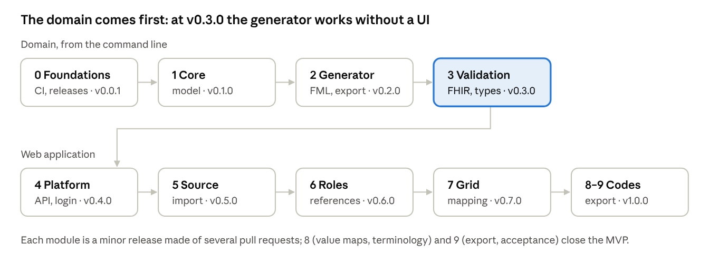

| Module | Concepts and features | Packages | Example branches | Release: done when |
| --- | --- | --- | --- | --- |
| 0. Foundations | No features: organization, monorepo, CI, releases, environment, docs skeleton | all (empty), `docker/`, `apps/docs` | `chore/monorepo-setup`, `chore/org-community-files`, `ci/github-actions`, `chore/changesets-release`, `chore/docker-compose`, `docs/site-skeleton`, `docs/specs-and-adr` | `v0.0.1`: CI green; `docker compose up` shows the Keycloak login; the "Version Packages" PR creates tag and images; the empty docs site is deployed |
| 1. Domain core | Project objects (table, column, role, row, value map, reference, status), integrity rules, project file (H3) | `model`, `cli` | `feature/model-json-schemas`, `feature/model-types-codegen`, `feature/model-integrity-rules`, `feature/h3-project-file-cli` | `v0.1.0`: `cindermed validate` accepts the two example projects; every integrity rule has a positive and a negative test |
| 2. Generator and package | G1, G2, G3, G7, G10 (grammar), H1 | `fml`, `normalizer`, `export`, `cli` | `feature/g2-fml-ast-printer`, `feature/g10-grammar-check`, `feature/g1-logical-model-normalization`, `feature/g2-generator-roles`, `feature/g2-generator-value-maps`, `feature/g7-export-manifest`, `feature/h1-csv-xlsx-export`, `ci/golden-tests` | `v0.2.0`: `cindermed export` on the two examples produces maps that pass the grammar and the golden tests in CI |
| 3. FHIR definitions and validation | D7 (paths, type compatibility, binding, cardinality), F4 | `fhir-defs`, `model` | `feature/fhir-defs-package-loader`, `feature/fhir-defs-element-tree`, `feature/d7-path-validation`, `feature/d7-type-compatibility`, `feature/d7-binding-checks`, `feature/f4-reference-checks`, `ci/npm-publish` | `v0.3.0`: `cindermed validate` flags the boolean on `Patient.name`; every cell of the compatibility table is tested in R4 and R5; core packages and `cindermed` published to npm |
| 4. Platform | A1, A2, A3; history as infrastructure | `api`, `web` | `feature/api-persistence-entities`, `feature/a2-auth-and-roles`, `feature/a3-optimistic-concurrency`, `feature/api-history`, `feature/a1-projects-ui` | `v0.4.0`: login, project creation, members with roles, 409 conflict handled in the UI, JSON import and export from the UI |
| 5. Source | B1–B6 | `api`, `web` | `feature/b1-b2-import-wizard`, `feature/b3-dictionary-import`, `feature/b4-b5-column-dictionary`, `feature/b6-source-editor` | `v0.5.0`: import of the Metastra FirstOverview: 100 variables, 11 sections, fixable warnings |
| 6. Roles and references | C1–C6, F1–F3 | `api`, `web` | `feature/c1-roles`, `feature/c2-c4-multiplicity-conditions`, `feature/c5-c6-fixed-values-ids`, `feature/f1-f3-references` | `v0.6.0`: the 6 roles of the Metastra example created from the UI, with automatic references from the context |
| 7. Mapping grid | D1–D5, D8, A5, A6 | `web`, `api` | `feature/d1-mapping-grid`, `feature/d2-grouping`, `feature/d3-path-picker`, `feature/d4-named-slices`, `feature/d5-transforms`, `feature/d8-bulk-actions`, `feature/a5-a6-status-comments` | `v0.7.0`: the 11 example variables mapped by hand give the same project file, ids and dates aside; the boolean on `Patient.name` is red |
| 8. Value maps and terminology | E1, E2, E4, E5, E6 | `terminology`, `api`, `web` | `feature/e1-value-map-editor`, `feature/e2-terminology-providers`, `feature/e4-coding-verification`, `feature/e5-shared-maps`, `feature/e6-value-actions` | `v0.8.0`: a LOINC code searched and assigned from the map; display verified |
| 9. Export and acceptance | G6 and the Export page (G7, G10, H1, H3 from the UI); user documentation | `web`, `api`, `apps/docs` | `feature/g6-fml-view`, `feature/export-page`, `test/e2e-acceptance`, `docs/metastra-walkthrough`, `docs/motu-walkthrough` | `v1.0.0`: complete FirstOverview (100 variables mapped, excluded or not mappable) exported without errors; golden and end-to-end tests green; docs site with the two walkthroughs published |

**After the MVP.** V2 and Future features are grouped into modules with the same rules.

| Module | Features | Priority |
| --- | --- | --- |
| Collaboration | A4 real-time presence, A7 history in the UI, A8 mapping releases | V2 |
| Advanced sources | B7 re-import with comparison, B8 sample data, B9 expanded multiple choices, B11 several tables | V2 |
| Reuse and expert tools | C7 templates, D6 expert expression, D9 copy and paste from Excel, F5 reference graph | V2 |
| Extended terminology | E3 other terminology servers, E7 local CodeSystems, E8 bulk check | V2 |
| Conversion | G4 preview, G5 Bundle validation, G9 dataset conversion, Matchbox | V2 (separate module) |
| Mapping documentation | H2 import of existing mapping sheets, H4 coverage report | V2 |
| Website and translations | Showcase website (`website` repository), Italian translation of UI and docs, GitHub Sponsors | V2 |
| Core extraction | Move the domain core to its own repository when an ADR-0001 criterion is met | When needed |
| Future | B10 derived columns, B12 join, G8 Liquid, H5 variables from FHIR Search, I1–I4 AI assistant | Future |

**Content of the `CLAUDE.md` file** (created in module 0, then kept up to date)

```markdown
# CinderMed (FHIR Mapping Workbench)

Multi-user web workbench to map tabular datasets to FHIR (R4/R5) and generate FML.
Full specification: docs/specification.md. Verified examples: fixtures/fml-examples.

## Scope
- Design for any tabular dataset that can be mapped to FHIR: check every new feature against a wide
  table, a long table and several related tables; Metastra, MOTU and MIMIC-IV are only examples.

## Workflow
- Work one module at a time, in the order of the "Incremental module plan".
- One feature per branch: feature/<id>-<name> (fix/, chore/, docs/, refactor/, ci/ for the rest).
- Commits and PR titles in Conventional Commits: <type>(<scope>): <description>.
  Scopes: model, fhir-defs, fml, normalizer, export, terminology, api, web, cli, docs, infra, deps.
- Every PR: tests, a changeset (pnpm changeset) if a package changes, description from the template,
  "Closes #n" for the issue. Open the PR with gh pr create; do not merge it: I review it.
- Never push directly to main. Squash merge.

## Language
- English everywhere: code, comments, messages, schemas, commits, PRs, issues, ADRs, docs.
- UI text only through i18n, with English as the source locale; Italian is added as a translation.
- Test data from Italian sources (values, date and number formats) stays as it is.

## Technical rules
- TypeScript strict everywhere, no `any`; model types are generated from the JSON Schemas in packages/model.
- Domain packages (model, fhir-defs, fml, normalizer, export) do no I/O and do not import apps/* (ADR-0001).
- The project (1.3.0), normalization (1.2.0) and manifest (1.0.0) schemas are contracts:
  an incompatible change needs a new major version, a migration and my approval.
- FML translation follows the "Translation rules" and "Generator contract" sections.
  The generator builds only FML tree nodes and never concatenates FML strings.
  Add a golden case that covers a rule before changing it.
- Type compatibility follows the table in the Architecture section; every new combination needs a golden case.
- Golden tests (fixtures/fml-examples) must stay green on every commit.
- Docs examples live in fixtures/ and run in CI; update the docs when user-visible behaviour changes.
- No patient data in the database or logs; no credentials in code, packages or logs.
- Every technical decision not covered by the specification goes in docs/adr/NNNN-title.md.

## Commands
- pnpm install / pnpm -r build / pnpm -r test / pnpm lint / pnpm typecheck / pnpm changeset
- docker compose up (full development stack)
- pnpm cindermed validate <project.json> / pnpm cindermed export <project.json>
- pnpm --filter docs dev (documentation site)

## Done
A module is finished only when its "done when" criterion is proven by tests and the release PR is merged.
```

## MVP, decisions and open items

The MVP includes 41 features. It is complete when the Metastra dictionary can be imported, corrected by hand, the FirstOverview form remapped from scratch and the project exported as FML, CSV and JSON, with StructureMaps that pass the official grammar.

**Components.** Stack, repository layout, services and Docker Compose are described in the Architecture section.

The grid uses TanStack Table instead of AG Grid, because AG Grid Community lacks row grouping.

**MVP scope by feature group:** A1, A2, A3, A5, A6 · B1–B6 · C1–C6 · D1–D5, D7, D8 · E1, E2, E4–E6 · F1–F4 · G1–G3, G6, G7, G10 · H1, H3.

**Decisions taken (9 November 2026)**

| Topic | Decision |
| --- | --- |
| Terminologies | Only free-licence terminologies (LOINC) through BioPortal with an API key; semantic code search will be a separate tool. BioPortal's LOINC is derived from UMLS and requires accepting the (free) UMLS licence; the official LOINC FHIR server (free LOINC account) is the planned alternative |
| Language of the code | TypeScript for frontend and backend |
| Environment | Prototype with Docker and Docker Compose; production on a server later |
| Multi-table sources | Data model ready for several tables from the start; one table per project in the MVP; several key-linked tables in V2 (B11), table joins in the future (B12) |
| Row and role ids | Generated automatically |
| Variables from FHIR Search | Open issue, not addressed now (H5) |
| FHIR versions | R4 and R5 available from the MVP |
| Data conversion | V2, as a separate software module (G4, G5, G9) |
| MVP outputs | FML, CSV/Excel and the JSON project file |
| Source correction | Import wizard and manual editing of the source grid in the MVP (B2, B3, B6) |
| FML verification | In the MVP only the official grammar (G10); compilation with Matchbox in V2; types checked in the grid with the compatibility table |
| Project language | English everywhere; Italian added later as a translation of the UI and of the documentation (ADR-0002) |
| Project name | CinderMed ("FHIR Mapping Workbench" stays as the descriptive subtitle). GitHub organization `CinderMed`, npm scope `@cindermed`, CLI command `cindermed` |
| Repositories | GitHub organization CinderMed with `workbench` (monorepo, documentation site included), `website` and `.github` |
| Domain core | Stays in the monorepo, isolated and published to npm; extracted to its own repository only when an ADR-0001 criterion is met |

**Still open**

- [ ] Liquid generator (G8): to evaluate only if a downstream system uses Microsoft FHIR-Converter.
- [ ] Variables obtainable only with FHIR Search (H5): how to document or generate them.
- [ ] SNOMED CT codes already in Metastra: they can be entered by hand but cannot be verified until there is a SNOMED source.
- [ ] Default LOINC source: BioPortal (UMLS licence to accept on the account) or the LOINC FHIR server; check which one returns the `LA…` answers.
- [ ] Matchbox: call format for loading the FML and handling R4 and R5 in the same container (V2, with the conversion module).
- [ ] Name reservations: the GitHub organization `CinderMed` is reserved; reserve the npm scope `@cindermed` (free on 10 November 2026) and a domain (`cindermed.org` or `cindermed.dev`).
- [ ] Licence (N14): Apache-2.0 proposed; needed before the repositories go public and before GitHub Sponsors.
